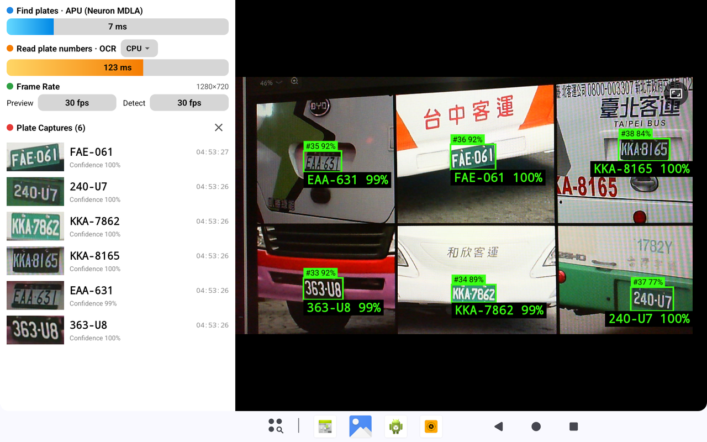
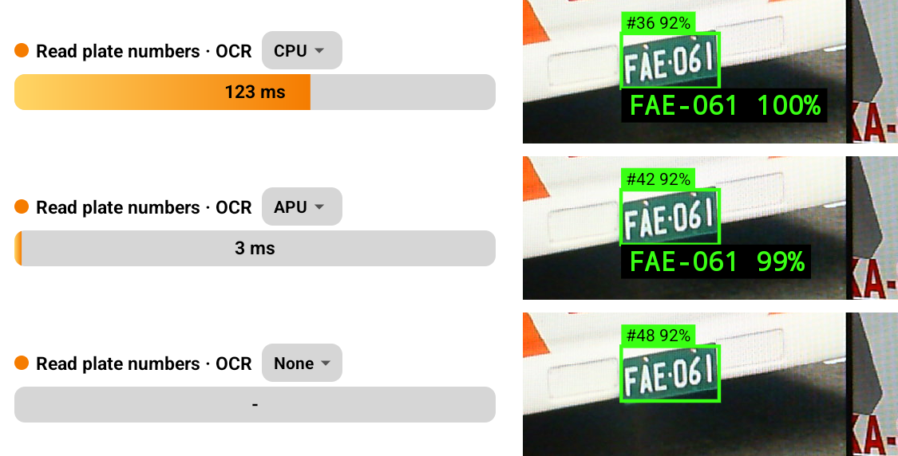
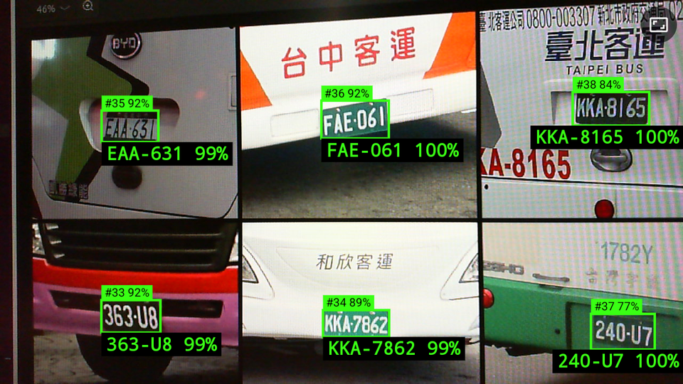
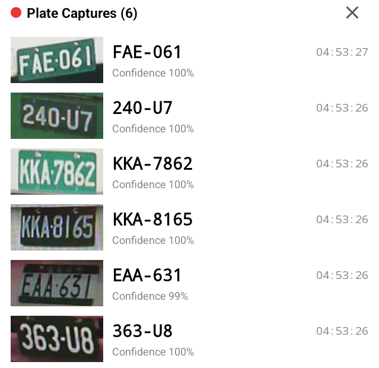

# LicensePlateRecognition (MTK G520, Android 16)

An Android app that recognizes Taiwanese license plates in real time. It reads video from a USB UVC camera, runs plate detection and text recognition on the device with no network connection, and lists the plates it reads. On MediaTek devices the detection model can use the APU; otherwise it falls back to the CPU.

## Features
- USB UVC camera support: opens automatically when only one camera is attached, offers a picker when there are several, and updates the picker on hot-plug
- Defaults to the highest resolution up to 1080p, with a manual resolution switch on screen
- Plate detection (YOLOv9-t, full INT8): starts on the CPU and switches seamlessly to the APU once it is ready in the background
- Plate text recognition (fast-plate-ocr cct-s-v2, fine-tuned on Taiwanese plates), with an on-screen selector for CPU, APU (a faster, less accurate model), or None (detection only)
- Multi-frame tracking and voting, with readings filtered against Taiwanese plate formats and separators restored; a reading with one uncertain character can vote but cannot lock a plate; it enters the capture list only through the vote, after 8 usable reads without a certain one
- Live overlay of plate boxes, numbers, and confidence on the preview; tap a box to discard its readings and recognize that plate again
- Plate capture list showing the thumbnail, number, confidence, and time of the latest appearance; each plate has one entry, up to 100 entries, and a button clears the list. A plate that returns after more than 30 seconds moves to the top and shows its appearance count, such as `×3`
- Metrics panel with detection and OCR latency, preview and detection frame rates, and the current resolution. Each section header names the task its time is spent on, "Find plates" for detection and "Read plate numbers" for OCR, followed by the detector status or OCR label
- Runs in landscape and keeps the screen on while in the foreground. The test device ignores app orientation requests, so the app locks the system rotation to landscape while it is in the foreground and restores it when you leave. This needs the "Modify system settings" permission, which the app asks for on first launch; until it is granted, the app uses its portrait layout

## Screenshots
**Main screen (landscape).** Metrics panel and plate capture list on the left, live camera preview on the right.



**OCR modes.** The same plate in each mode, from top to bottom: CPU, APU, and None. None draws the box but reads no number and adds nothing to the capture list.



| Mode | OCR time in this shot | Reading |
|------|-----------------------|---------|
| CPU | 123 ms | `FAE-061`, 100% |
| APU | 3 ms | `FAE-061`, 99% |
| None | None | No number |

The displayed time is the last read before the plate locks, so it varies: APU reads in the app were seen from 3 to 10 ms, and the first reads after loading can reach about 14 ms. Both models read this plate correctly. One plate does not show the accuracy difference; see [Why OCR Runs on the CPU](#why-ocr-runs-on-the-cpu).

**Live overlay.** Each detected plate shows its tracking ID and detection score above the box, and the recognized number and reading confidence below it. Tap a box to recognize that plate again.



**Plate capture list.** Each entry shows the plate thumbnail, number, confidence, and time of the latest appearance. The X button clears the list.



## Requirements
- Android 9 (API 28) or later, arm64-v8a
- A device with USB Host support and a UVC camera
- APU acceleration needs a MediaTek device that provides the Neuron libraries; otherwise the app uses the CPU

For development:
- JDK 21 (`release.sh` uses `$HOME/.jdks/jbr-21.0.11`)
- Android SDK 35
- `signing.storePassword`, `signing.keyAlias`, and `signing.keyPassword` set in `local.properties`, and the keystore `innocomm.jks` in the project root

Measured at 1280×720: about 4–8 ms for APU detection, about 123 ms for CPU OCR, and about 30 fps for both preview and detection.

## Architecture

```
UVC camera → UvcCameraController → MainViewModel → DetectionPipeline
                                                      ├─ PlateDetector (detection) → PlateTracker (tracking, voting)
                                                      └─ PlateCropper → PlateOcr (text recognition)
                                                                              ↓
MainActivity ← LiveData ← MainViewModel (PlateCaptureList, metrics, detector status)
```

| Stage | Model | Runs on | What it does |
|-------|-------|---------|--------------|
| Camera input | None | CPU | Receives NV21 frames from the UVC camera |
| Plate detection | YOLOv9-t 416 (INT8) | APU, or CPU as fallback | Finds plate boxes in each frame |
| Tracking | None | CPU | Matches boxes across frames by overlap and assigns IDs |
| Cropping | None | CPU | Cuts each plate from the full-resolution frame and scales it to 128×64 |
| Text recognition | `cct-s-v2` (default) or `crnn_cnn` (INT8) | CPU or APU, selectable; can be turned off | Reads the plate number |
| Filtering and voting | None | CPU | Rejects invalid formats and low confidence, then votes across frames |
| Display | None | CPU | Draws the overlay and updates the capture list |

| Location | Contents |
|----------|----------|
| `camera/` | Wrapper around the UVCAndroid camera flow, and resolution selection |
| `detection/` | Inference backends, detection and OCR, tracking, plate formats, capture list |
| `ui/` | Activity, ViewModel, layouts, and custom views |
| `datasets/` | Training, evaluation, and on-device screen test data, grouped by purpose (see `datasets/README.md`); not shipped with the app |
| `tools/` | Python scripts for model conversion, OCR training data preparation, accuracy evaluation, and APU model training (`ocr_ctc/`) |

- **State:** Display data and the detection pipeline live in `MainViewModel`, so they survive Activity recreation and the models do not need reloading. The camera is tied to the `TextureView` and foreground state, so `MainActivity` manages it. Data is kept in memory only and is cleared when the app process ends.
- **OCR mode from adb:** For tests and screenshots, switch modes with `adb shell am start -n com.innocomm.lpr/.ui.MainActivity --es ocr_mode APU` (or `CPU`, `NONE`). Injected taps from `adb shell input` crashed `system_server` on the test device twice, so prefer this command.
- **Threading:** Detection and OCR each have their own thread. New frames are dropped while the previous one is still processing, so latency does not build up.
- **Box smoothing:** The drawn box goes through `BoxSmoother` (an alpha-beta filter) so it does not jitter. It is display only: tracking and OCR cropping use the raw detection box.
- **APU cache:** The first APU model compilation on a device takes more than ten minutes, so the APK bundles a precompiled cache (`assets/neuron_cache`). Each model gets its own directory, `noBackupFilesDir/neuron_cache/<SHA-256 of the model file>`, because the Neuron cache does not separate models by token, so a model with new weights could otherwise keep running the old compilation. The bundled cache holds only the detection model, was built on the same device model, and is copied to that model's directory on first use. It is installed only when the model's hash matches `BUNDLED_CACHE_MODEL_SHA256` in `InferenceEngine.kt`. When replacing the detection model, regenerate the cache and update that value; otherwise the new model simply compiles on the device. If it is missing or unusable, the app is expected to recompile on the device and detect on the CPU until that finishes. The APU OCR model compiles in about 3 seconds, so it is not bundled.

## Models

The app bundles three models. Both OCR models contain weights trained by this project; the detection model does not.

| Model | App component | Asset | Trained by this project? | License | Origin and processing |
|-------|---------------|-------|--------------------------|---------|-----------------------|
| Plate OCR (default) | `CpuPlateOcr` (plate text recognition, on the CPU) | `plate_ocr_cct_s_v2.tflite` | **Yes, fine-tuned** | Copyright © 2026 InnoComm, MIT for this project's fine-tuning. Derived from fast-plate-ocr `cct-s-v2-global`, whose weights license is unconfirmed | Started from the pretrained fast-plate-ocr `cct-s-v2-global` weights, then fine-tuned for 30 epochs on Taiwanese plates (about 5,400 training and 520 validation crops). In November 2026 it was fine-tuned again for 20 epochs with 8,000 synthetic plates in the official layouts and 87 real green commercial plates added, which raised accuracy on green, electric, and red plates. The region classification output was removed before conversion to TFLite. |
| Plate OCR (APU option) | `ApuPlateOcr` (plate text recognition, on the APU) | `plate_ocr_crnn_cnn_v4_int8.tflite` | **Yes, from scratch** | Copyright © 2026 InnoComm, MIT | CRNN-style convolutional model with CTC decoding, trained for 80 epochs on the same crops as the default model, then for 40 more with 8,000 synthetic plates added, and for 30 more with 87 real green commercial plates added. In November 2026 its input was raised from 128×32 to 128×64 (v4), and it was trained for 25 more epochs with stronger tilt and perspective augmentation, then 10 more with 2,000 synthetic plates containing Q added, because Q and 0 were often confused. Converted to full INT8. |
| Plate detection | `PlateDetector` (plate boxes, on the APU or CPU) | `plate_yolov9t_416_int8.tflite`, compiled cache in `neuron_cache/` | No | Upstream terms; see Models and Datasets below | Pretrained open-image-models YOLOv9-t 416, with weights unchanged by training. Decoding and NMS were cut from the graph, and it was converted to full INT8 using real plate images for calibration. |

Both OCR models were trained on the EZCon dataset, which declares no license, on 87 photos from Wikimedia Commons under various Creative Commons licenses, and on synthetic plates built from glyphs cut from the Highway Bureau sample chart. Whether trained weights are derivative works of their training data is legally unsettled, so InnoComm's MIT license on these models does not override the terms of the pretrained weights and training data they build on.

Official plate samples: the [Highway Bureau page](https://www.thb.gov.tw/cp.aspx?n=102) and the [sample sheet for current and older plates](images/原型式號牌與新式號牌各車別示意圖.pdf).

The OCR training crops are generated by `tools/prepare_ocr_dataset.py`. The Keras checkpoint and training configuration of the default model are not in this repository. Training scripts and weights for the APU model are in `tools/ocr_ctc/`.

### Why OCR Runs on the CPU

The default model cannot run on the APU because it needs `BATCH_MATMUL`, which the APU does not support. Models built for the APU are much faster but less accurate, so CPU stays the default and `crnn_cnn` is offered as the APU option.

| Model | Runs on | Inference time | Low-res test set | Clean test set | Low-res, wrong but accepted |
|-------|---------|----------------|------------------|----------------|-----------------------------|
| **Default model** (`cct-s-v2`, fine-tuned) | CPU | About 109 ms | **98.82%** | **100%** | **3** |
| `crnn_cnn` v4 (INT8, 128×64) | APU | About 4.7 ms | 95.67% | 96.46% | 10 |
| `crnn_ds` (INT8) | APU | About 3.1 ms (model only) | 93.31% | 94.88% | 11 |

Accuracy is exact whole-plate matches on 254 single images, measured with TFLite on a PC. Photos too blurry or cut off to read by eye were left out (listed in `datasets/training/ocr_crops/test_clean_excluded.csv`). These test images are mostly white private-car plates; on the per-style set in `datasets/evaluation/plate_styles/` (149 web photos), the default model reads 98% overall, including 97% of green commercial plates and all 13 electric plates. Timing was measured on the MTK G520. For the default model and `crnn_cnn`, it is the average OCR time over the 108 vehicle photos in `OcrAccuracyTest`, including input conversion and decoding, in a debug build; single APU reads range from about 4 to 10 ms. `crnn_ds` is not in the app, so its time covers model inference only, on random input, at its 128×32 input. CRNN with LSTM and SVTR-Tiny failed to compile for the APU. Raising the `crnn_cnn` input to 128×64 cut its errors by about a third at almost no cost in speed: the APU model alone takes about 3.5 ms instead of 2.9 ms. It is still clearly less accurate than the default model. On the device, over the 108 vehicle photos, the default model read 102, `crnn_cnn` v4 read 99, and v3 read 97. On the official sample sheet, the default model read all 23 new-style and 22 older plates, and `crnn_cnn` read 23 and 21.

## Adapting to Other Countries

The app currently assumes Taiwanese plates in two places: the format rules and the fine-tuned OCR model. Start with the format rules, because they discard any reading that does not match, so most foreign plates would never appear in the list. The steps below are guidance; this app has not been ported to another country yet.

1. **Replace the format rules.** Update `KNOWN_FORMATS` and `display()` in `TaiwanPlateFormat.kt`, along with `TaiwanPlateFormatTest`. `isValid()` decides which readings are accepted (through `isUsable()` in `PlateTracker.kt`), and `display()` restores separators for the overlay and the capture list.
2. **Evaluate the OCR model on local plates.** The bundled model was fine-tuned on Taiwanese plates, so measure both it and the original `cct-s-v2-global` model. The original covers 0–9 and A–Z across many regions, reads up to 10 characters, and is the better starting point for fine-tuning.
3. **Fine-tune the OCR model if accuracy is too low.** Collect labeled local plates, including small and heavily compressed ones like those seen on real cameras. `tools/prepare_ocr_dataset.py` needs changes first, because it has hard-coded dataset paths under `datasets/training/` and `datasets/evaluation/` and a `license_number` label column. Then convert the result with `tools/convert_ocr_model.py` and replace `plate_ocr_cct_s_v2.tflite`.
4. **Train a new OCR model for non-Latin characters.** Arabic, Chinese, Cyrillic, Hangul, Thai, and similar scripts are outside the current alphabet, so fine-tuning the existing model is not enough. Update `PlateTextDecoder.ALPHABET` to match the new model, and the `A-Z0-9` filter in `tools/prepare_ocr_dataset.py`. The overlay and list fonts must also be able to display the new characters.
5. **Check plate shapes.** Plate crops are stretched to 128×64 without keeping their aspect ratio. Test two-line, square, and long narrow plates specifically, as they may need training data or preprocessing of their own.
6. **Check the detector.** The YOLOv9-t model comes from a general plate model and was not retrained for Taiwan, so it may work unchanged. Measure it with `tools/evaluate_model.py` before retraining. If you replace it, run `tools/convert_model.py`, regenerate `assets/neuron_cache`, and update `BUNDLED_CACHE_MODEL_SHA256` in `InferenceEngine.kt`.
7. **Retune the thresholds.** These values were chosen from Taiwanese test data or footage: `PADDING_X` and `PADDING_Y` in `PlateCropper.kt`, and `MIN_READING_CONFIDENCE` and `MIN_OCR_WIDTH_PX` in `PlateTracker.kt`.
8. **Validate on real footage.** Use `tools/evaluate_video.py` on local video, and `tools/export_ocr_samples.py` with `OcrAccuracyTest` on the device. `tools/evaluate_video.py` has its own copy of the alphabet and format rules, so keep it in sync with the app.
9. **Review the licenses.** Check the license of every new dataset and model, and update the tables below.

## Files Not in the Public Repository

Some files cannot be published, so the public GitHub version of this project leaves them out:

- **MediaTek NeuroPilot SDK** (`app/libs/neuropilot-T-20220701-I6a8d.aar`) and the precompiled APU cache (`app/src/main/assets/neuron_cache/`). Both are MediaTek proprietary. Without the SDK the project does not build; without the cache, the detection model compiles on the device on first use, which takes more than ten minutes.
- **Signing keystore and passwords** (`innocomm.jks` and `local.properties`). Set up your own keystore and signing values to build.
- **Training and evaluation scripts and data** (`tools/` and `datasets/`), mentioned elsewhere in this README. Some of the datasets have no stated license or are shared under CC BY-SA.
- **Internal documents.**

For the NeuroPilot SDK, these files, or other questions about this project, contact InnoComm Mobile Technology Corp: https://www.innocomm.com/

## License
This project is licensed under the [MIT License](https://opensource.org/license/mit).
Copyright © 2026 InnoComm Mobile Technology Corp (https://www.innocomm.com/)


